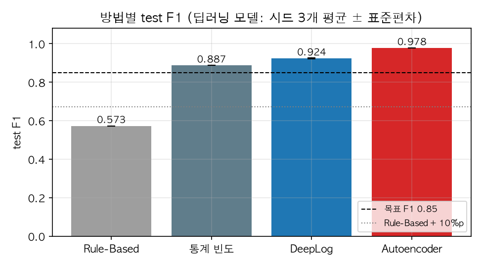
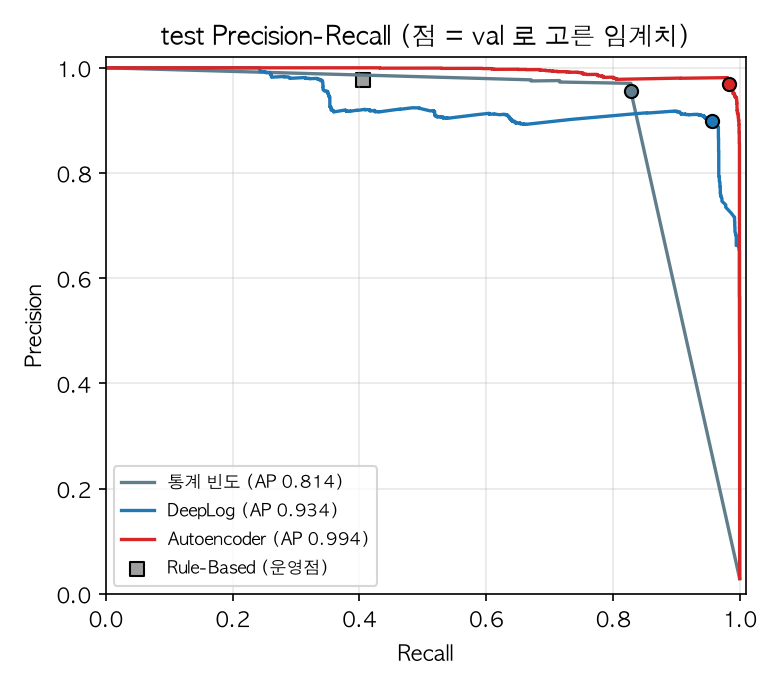
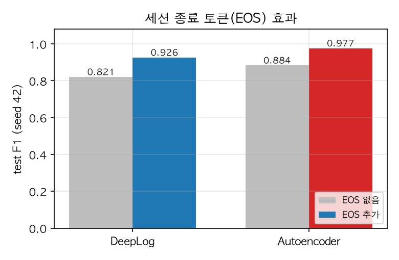
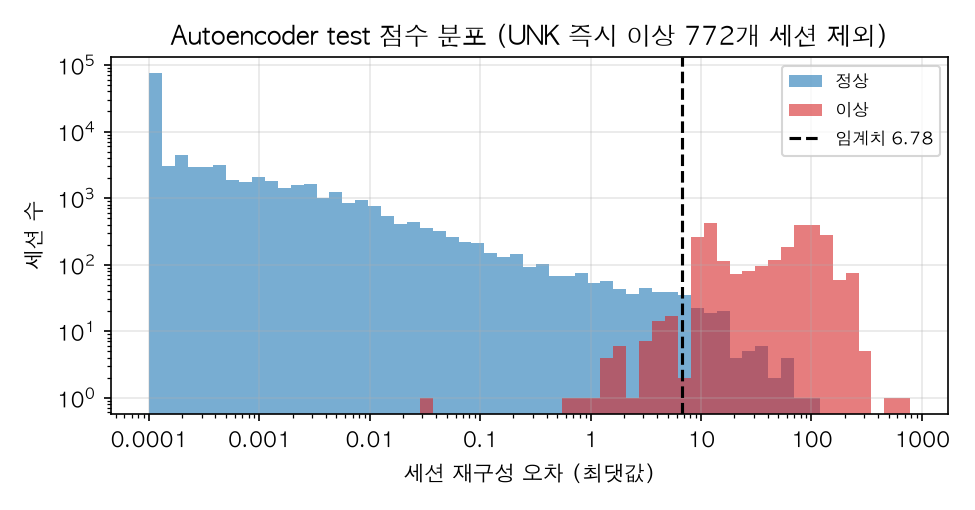

# DeepLog-Guard — AI 기반 실시간 서버 로그 이상 탐지 및 알림 시스템

동의대학교 컴퓨터공학과 딥러닝 팀 프로젝트 **7조** (담당교수 임환섭, 2026.09.11 ~ 2026.12.21)

HDFS 로그를 Drain으로 파싱 → Block ID 세션 → 슬라이딩 윈도우 → **Autoencoder vs DeepLog(LSTM)** 이상 탐지 →
FastAPI 실시간 추론 → SQLite 저장 → Slack 알림 + Streamlit 대시보드.

## 목표 (계획서 기준)

| 항목 | 목표 |
|---|---|
| F1-score (HDFS, 세션 단위) | **≥ 0.85** (Precision·Recall 병기) |
| Rule-Based Baseline 대비 | **F1 +10%p 이상** |
| 추론 지연 (FastAPI 수신 → 판정) | p95 **≤ 1초** |
| End-to-End (Replay 전송 → Slack 요청 완료) | **≤ 2초** |
| 처리량 (Locust) | **500 logs/s × 1분 이상**, 오류율 < 1% |

## 팀 / 담당 폴더

| 이름 | 역할 | 주 작업 폴더 |
|---|---|---|
| 옥상민 (팀장) | AI/Data · 총괄 | `src/logguard/data`, `models`, `baseline`, `eval` |
| 안명근 | Backend | `src/logguard/api` (FastAPI, Log Replay, SQLite, Locust) |
| 이동준 | Dashboard | `src/logguard/dashboard` (Streamlit, Slack Webhook) |

## 폴더 구조

```
dplngproj/
├── configs/
│   ├── config.yaml          # 경로·분할 비율·윈도우·베이스라인 설정 (모든 코드가 여기서 읽음)
│   └── drain3.ini           # Drain3 마스킹 규칙 / sim_th / depth
├── src/logguard/
│   ├── config.py            # load_config(), 프로젝트 루트 경로
│   ├── data/
│   │   ├── download.py      # HDFS_v1 다운로드·압축 해제
│   │   ├── parse.py         # Drain3 파싱 → 라인/템플릿/세션 테이블 + Drain 상태 저장
│   │   ├── split.py         # Block ID 단위 train/val/test 분할 + 이벤트 어휘
│   │   ├── drain_tuning.py  # Loghub 공식 템플릿 대비 Drain 검증·sim_th/depth 튜닝
│   │   ├── online.py        # 실시간 파서: 로그 1줄 → Event ID, Block ID (백엔드용)
│   │   └── windows.py       # 슬라이딩 윈도우 (DeepLog / Autoencoder 입력)
│   ├── baseline/rule_based.py   # 키워드·정규식 + 빈도 임계치 베이스라인
│   ├── eval/
│   │   ├── metrics.py       # Precision/Recall/F1, 백분위수 임계치
│   │   ├── final_eval.py    # 6단계 test 1회 평가·목표 달성 정리
│   │   └── figures.py       # 보고서 그래프 → docs/figures/
│   ├── models/
│   │   ├── dataset.py       # 세션 → 윈도우 (중복 압축, EOS/UNK)
│   │   ├── scoring.py       # 세션 점수·임계치 선택·0~1 정규화·결과 저장
│   │   ├── train_utils.py   # 시드·장치·가중 학습 루프
│   │   ├── inference.py     # Detector 인터페이스 (백엔드용, docs/interface_backend.md)
│   │   ├── deeplog.py       # DeepLog LSTM + EOS, 학습·val 평가·Detector
│   │   ├── autoencoder.py   # MLP Autoencoder (원-핫 윈도우 재구성), Detector
│   │   ├── seed_study.py    # 시드별 성능 편차 측정
│   │   └── tune.py          # 하이퍼파라미터 그리드 × 시드 튜닝 (val)
│   ├── api/                 # 백엔드 (안명근): FastAPI 수신·판정·저장, 로그 재생, Locust
│   │   ├── main.py          #   POST/GET /logs, POST /sessions/close, GET /sessions, /stats
│   │   ├── predictor.py     #   모델 연결 어댑터 (Detector → Predictor)
│   │   ├── schema.sql       #   ★ 통합 DB 규격 (백엔드·대시보드 공용, docs/db_schema.md)
│   │   └── replay.py        #   HDFS.log 를 순서대로 재생 (--test-sessions, --close-sessions)
│   └── dashboard/           # 대시보드 (이동준): Streamlit 화면, 읽기 전용 SQLite 조회
├── tests/                   # pytest (원본 데이터 없이 실행)
├── notebooks/               # EDA·실험 노트북 (01_eda.ipynb: 데이터 점검·Drain 검증)
├── data/                    # ⚠️ git 미포함 — `make data` 로 생성
│   ├── raw/HDFS_v1/         # HDFS.log (1.5GB), preprocessed/anomaly_label.csv
│   ├── interim/             # 파싱 결과
│   └── processed/           # 분할 결과
├── artifacts/               # drain3/ 상태, models/*.json Detector 설정 (git 포함)
├── results/                 # 모델·베이스라인 평가 결과 json
└── docs/                    # 개발 일정(schedule.md), 실행 계획(plan_week4-6.md), 백엔드 인터페이스(interface_backend.md), figures/
```

## 시작하기

```bash
# 1) 환경 (uv 필요: brew install uv)
make setup

# 2) 데이터: 다운로드 → Drain 파싱 → 세션 분할  (파싱 수 분 소요)
make data

# 3) Rule-Based Baseline
make baseline

# 4) 테스트
make test
```

`make` 없이 실행: `.venv/bin/python -m logguard.data.parse --limit 100000` 처럼 모듈 단위 실행 가능 (`--limit` 은 빠른 테스트용).

## 데이터 규칙 (누수 방지 — 반드시 지킬 것)

- 분할 단위는 **Block ID 세션**. 같은 블록의 윈도우가 서로 다른 셋에 들어가면 안 된다.
- **train = 정상 세션만**. 이상 세션은 버리고 개수만 `split_summary.json` 에 기록.
- **임계치 = val 의 정상 세션(label==0) 이상 스코어의 백분위수** (`eval.metrics.percentile_threshold`).
- **test = 실제 클래스 분포 유지** (기본 `strategy: random` 은 라벨별 층화 분할, `chrono` 는 시간순).
- 최종 지표는 **세션 단위** (세션 내 윈도우 하나라도 이상이면 세션 이상)로 `eval.metrics.prf()` 로 계산.

## 데이터 파일 명세

| 파일 | 내용 |
|---|---|
| `data/interim/hdfs_lines.parquet` | 원본 라인 순서대로 `date, time, level, component, event_id` (행 번호 = HDFS.log 줄 번호, 0부터) |
| `data/interim/hdfs_templates.csv` | `event_id, event_key(E#), template, occurrences, levels` |
| `data/interim/hdfs_sessions.parquet` | `block_id, first_line, last_line, length, events(list[int]), label(0/1)` |
| `data/processed/{train,val,test}.parquet` | 위 세션 테이블의 분할본 |
| `data/processed/event_vocab.json` | 모델 입력 인덱스 (0=PAD, 1=UNK, train 에 나온 이벤트만 2부터) |
| `artifacts/drain3/drain3_state.bin` | FastAPI 에서 `TemplateMiner` 로 로드해 `match()` 로 Event ID 매칭 |

## 최종 결과 (HDFS test, 세션 단위) — 2026-10-12 6단계

데이터: 세션 575,061개 · 이상 16,838개(2.93%) · Drain 템플릿 52개(sim_th 0.85, Loghub 공식 시퀀스와 100% 일치) · Block ID 층화 분할 6:2:2 (seed 42).
모든 설정·임계치는 val 로만 선택했고 test 는 마지막에 1회 평가했다 (`results/final_test.{json,csv}`).

| 방법 | Precision | Recall | F1 (배포 모델) | F1 시드 3개 평균 ± 표준편차 |
|---|---|---|---|---|
| Rule-Based (키워드·정규식 + 세션 길이) | 0.976 | 0.406 | 0.573 | — |
| 통계 빈도 (이벤트별 빈도 임계치) | 0.955 | 0.828 | 0.887 | — |
| DeepLog + EOS (w=20, LSTM 2×128) | 0.898 | 0.956 | 0.926 | 0.924 ± 0.002 |
| **Autoencoder + EOS (w=20, 잠재 32) — 최종 채택** | **0.970** | **0.984** | **0.977** | **0.978 ± 0.001** |

| 계획서 목표 | 결과 | 달성 |
|---|---|---|
| ① F1 ≥ 0.85 | 0.977 | ✅ |
| ② Rule-Based 대비 F1 +10%p | +40.4%p (통계 빈도 대비로도 +9.0%p) | ✅ |
| ③ 추론 p95 ≤ 1초 | 로그 1줄 파싱 + 판정 p95 **0.10ms** (HTTP·DB 제외, E2E 2초는 백엔드 통합 후 측정) | ✅ (모델 구간) |
| ④ 500 logs/s | 단일 스레드 약 10,700 줄/초 (Locust 부하테스트는 통합 후) | ✅ (모델 구간) |
| ⑤ 두 모델 비교 후 채택 | Autoencoder 채택 (DeepLog 대비 F1 +5.4%p 시드 평균, 추론 약 5배 빠름) | ✅ |
| ⑥ 대시보드·Slack | 이동준 담당, 진행 예정 | — |

| 방법별 F1 | Precision-Recall |
|---|---|
|  |  |
| **EOS 효과** | **Autoencoder 점수 분포** |
|  |  |

주요 발견
- **EOS(세션 종료) 토큰**: 이상 세션의 약 37%가 중간에 끊긴 세션이라, 다음 이벤트만 보는 기본 모델은 놓친다. EOS 추가로 test F1 DeepLog 0.821 → 0.926, Autoencoder 0.884 → 0.977
- **Drain 튜닝**: 기본 sim_th 0.5 는 이상 신호(`Interrupted`)를 정상 이벤트에 합쳐버림 → 0.85 로 수정
- **val ↔ test 일치**: Autoencoder val 0.972 / test 0.977 — val 기반 선택이 과적합되지 않음
- 과정 상세: `docs/plan_week4-6.md`, 실험 결과: `results/`

## 협업 규칙

- `main` 직접 push 금지 → `feat/<영역>-<내용>` 브랜치 + PR, 1명 이상 리뷰 후 merge
- 비밀값(Slack Webhook URL 등)은 `.env` 에만, **절대 커밋 금지**
- 설정값은 코드에 하드코딩하지 말고 `configs/config.yaml` 에 추가
- 실험 결과는 `results/<model>.json` 으로 저장해 베이스라인과 같은 형식으로 비교

## 참고

- Du et al., *DeepLog*, CCS 2017 · He et al., *Drain*, ICWS 2017 · He et al., *Loghub*, arXiv:2008.06448

## 전체 시스템 실행 (백엔드 + 재생 + 대시보드)

**가장 쉬운 방법: `start.sh` 한 번** (백엔드·대시보드·로그 재생을 한꺼번에 켜고, Ctrl+C 한 번으로 모두 종료)

```bash
./start.sh            # 빠른 시연: test 로그 2만 줄 (약 1분), 대시보드가 브라우저로 열림
./start.sh full       # 전체 test 재생 약 1시간 + 세션 종료 판정 → 최종 F1 0.977 재현
./start.sh serve      # 재생 없이 서버·대시보드만 (http://127.0.0.1:8000/docs 에서 직접 테스트)
LIMIT=50000 RATE=500 ./start.sh   # 옵션: 줄 수, 초당 속도 / KEEP_DB=1 이전 DB 이어 쓰기 / NO_BROWSER=1
```

대시보드 사이드바에서 데이터 소스를 **SQLite** 로 바꾸면 실시간 결과가 보인다. 실행 기록은 `artifacts/run_logs/`.

터미널 3개로 따로 켜는 방법:

```bash
make api                         # 터미널 1: FastAPI 서버 (Autoencoder 판정, http://127.0.0.1:8000/docs)
make replay                      # 터미널 2: test 블록 로그 재생 → 끝나면 세션 종료 판정
make dashboard                   # 터미널 3: Streamlit → 사이드바에서 "SQLite" 선택
```

- 실시간 경보(로그마다 판정): test F1 0.880 / 세션 종료 판정 포함 최종: test F1 0.977
- DB 구조: `docs/db_schema.md` (규격), `docs/db_design.md` (설계 계획서), 백엔드 상세: `src/logguard/api/README.md`

## Streamlit 대시보드

```bash
# make setup으로 환경을 구성한 후
make dashboard
# 또는
.venv/bin/python -m streamlit run src/logguard/dashboard/app.py
```

기본은 **데모 데이터** 모드입니다. DB나 학습된 모델 없이 화면을 확인할 수 있습니다.
데모 로그·스코어·지연·Slack 이력은 합성 데이터이며, 모델 평가 탭은 실제 `results/final_test.csv`(6단계 test 결과)를 읽습니다.
대시보드는 알림을 전송하지 않으며 SQLite를 읽기 전용으로 조회합니다.

- 상단: 관측 세션 수, 이상 세션 수·비율, Slack 전송 성공 수
- 실시간 모니터링: 모델별 스코어·임계치(0.5), 지연 p95, 최근 추론 윈도우와 **판정 근거**, CSV 다운로드
- 세션 상세: Block ID별 윈도우 이력, 세션 종료 판정 여부(진행 중 / 정상 종료 / 끊긴 세션)
- 알림 이력: 전송 성공·실패·대기 기록
- 모델 평가: Rule-Based·통계 빈도·DeepLog·Autoencoder(+EOS 비교)의 test Precision/Recall/F1
- 사이드바: 데이터 소스, 조회 기간, Block ID 검색, 이상 세션 필터, 자동 갱신

### 백엔드 연동 규격 (2026-10-20 통합)

DB 규격은 백엔드와 공유하는 [`src/logguard/api/schema.sql`](src/logguard/api/schema.sql) 하나이며 설명은
[`docs/db_schema.md`](docs/db_schema.md)에 있습니다. 백엔드가 테이블을 만들고 기록하며 대시보드는 읽기만 합니다.
기본 DB 경로는 `configs/config.yaml`의 `dashboard.database_path` (`artifacts/api/logguard.sqlite`, 백엔드와 같은 파일)입니다.

- `logs`: 로그 1줄 × 블록 1개. 대시보드는 판정된 행(`status` normal/anomaly)만 읽습니다
- `session_results`: 세션 종료(EOS) 판정. 세션 판정 = **윈도우 OR + 종료 판정** (같은 모델·Block ID 기준)
- `alerts`: Slack 알림 이력. 전송·중복 방지는 Slack 알림 작업자(`dashboard/notifier.py`)가 하며, 블록·모델당 1건만 저장됩니다

조회 기간은 **최신 기록 시각**을 기준으로 계산하여 과거 Replay도 조회할 수 있습니다.
최대 조회 행 수는 `dashboard.max_rows`이며 상한에 도달하면 경고합니다.

대시보드 검증: `.venv/bin/python -m pytest tests/test_dashboard.py -q`.

## Slack 이상 알림 설정

Slack은 팀용 메신저이며, 여기서는 텔레그램 봇 알림처럼 이상 세션 알림을 채널로 받는 용도입니다.
Incoming Webhook이 연결된 채널에 알림을 게시하고, 모바일 Slack 앱에서 해당 채널의 알림을 켜면 휴대폰으로도 받을 수 있습니다.

1. Slack 워크스페이스에 가입하거나 새로 만들고 `#logguard-alerts` 같은 전용 채널을 만듭니다.
2. https://api.slack.com/apps 에서 **Create New App → From scratch**로 앱을 만듭니다.
3. 앱 설정 **Incoming Webhooks → Activate Incoming Webhooks**를 켭니다.
4. **Add New Webhook to Workspace**에서 알림 채널을 선택하고 허용합니다.
5. 발급된 Webhook URL을 프로젝트 루트의 `.env`에 아래 형식으로 저장합니다. 채팅이나 Git에 올리지 않습니다.

```dotenv
SLACK_WEBHOOK_URL=여기에_발급받은_URL
```

```bash
make slack-preview   # 먼저 대상 메시지 확인: Slack 전송·DB 변경 없음
make slack           # 실제 전송: 별도 터미널에서 실행, Ctrl+C로 종료
# 한 배치만 전송하려면
PYTHONPATH=src .venv/bin/python -m logguard.dashboard.notifier --once
```

백엔드를 먼저 실행해야 DB가 생성됩니다. `start.sh`는 알림 작업자를 자동으로 켜지 않습니다.
알림 설정값은 `configs/config.yaml`의 `slack`에 있고 DB 경로는 백엔드 설정(`LOGGUARD_API_CONFIG` 지원)을 따릅니다.
외부 전송은 Webhook을 설정하고 `make slack`을 실행했을 때 시작됩니다. **기존 DB의 미알림 이상도 대상**입니다.

작업자는 `logs.is_anomaly=1` 또는 `session_results.is_anomaly=1`인 세션을 찾고,
`alerts`의 UNIQUE(block_id, model_name)으로 전송 대상을 선점합니다. Slack 응답이 성공이면 `sent`,
실패하면 `failed`와 오류·완료 시각을 기록합니다. 성공한 세션의 로드된 로그에 `alerted=1`을 설정합니다.
세션 종료에서만 이상으로 판정되면 `alerts.log_id`는 NULL입니다. 대시보드의 알림 이력 탭에서 결과를 확인합니다.

중복 전송을 피하기 위해 실패·타임아웃은 자동 재시도하지 않습니다. 요청이 실제 전달됐는지 Slack 채널에서 확인해야 합니다.
전송 중 프로세스가 종료되면 해당 기록은 `pending`으로 남을 수 있으며 자동 재전송하지 않습니다.
즉, DB 중복 선점은 막지만 HTTP 전송과 DB 저장을 완전히 하나의 트랜잭션으로 만들 수는 없습니다.
한 채널에 약 1초 간격으로 보내므로 대량 이상이 쌓이면 E2E 2초 목표를 넘길 수 있습니다.
공식 설정 문서: https://docs.slack.dev/messaging/sending-messages-using-incoming-webhooks

### Slack 알림이 발생하는 조건

`make slack`으로 알림 작업자를 실행하면 기본 **0.5초마다 DB를 확인**합니다.
대시보드의 버튼이나 새로고침이 전송을 트리거하지 않습니다.

| 상황 | DB 조건 | 예시 |
|---|---|---|
| 실시간 이상 감지 | `logs.is_anomaly = 1` | 모델이 이상으로 판정하거나 학습에 없던 이벤트 등장 |
| 세션 종료 시 이상 감지 | `session_results.is_anomaly = 1` | EOS 판정에서 중간에 끊긴 세션 등 이상 감지 |

- 정상 세션에는 알림을 보내지 않습니다.
- **같은 모델 + Block ID는 한 번만 알립니다.** 실시간에 이미 알렸다면 종료 판정 때 다시 보내지 않습니다.
- 작업자를 켜기 전에 DB에 저장된 미알림 이상도 전송 대상입니다.
- `alerts`에 이미 `pending`, `sent`, `failed` 중 어떤 상태로든 기록된 세션은 자동 재전송하지 않습니다.
- 실패·타임아웃은 기록만 남기며 자동 재시도하지 않습니다. 대상·상태는 대시보드 알림 이력에서 확인합니다.
- `slack.poll_seconds`는 대상 조회 간격이고, 실제 전송은 `slack.send_interval_seconds` 간격을 둡니다.

시연 서버를 다른 팀원이 실행하면 Webhook URL은 비공개 경로로 별도 전달하고,
그 서버의 프로젝트 루트 `.env`에 저장해야 합니다. `.env`와 `.env.*`는 `.gitignore` 대상이며,
실제 URL을 README·PR·커밋에 포함하지 않습니다.
