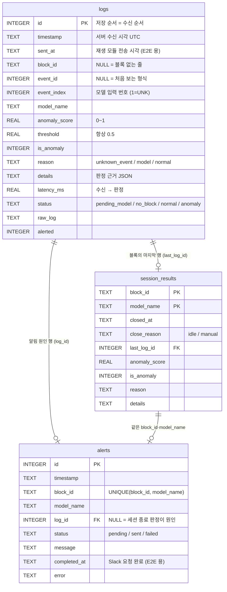
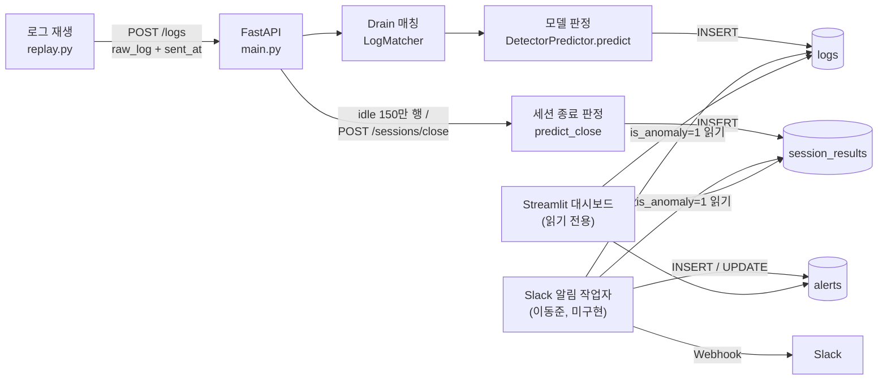

# DB 설계 계획서

- 작성: 옥상민 (팀장) / 2026-10-20
- 대상: 7조 DeepLog-Guard 실시간 추론 서버(FastAPI) · 대시보드(Streamlit) · Slack 알림 작업자가 함께 쓰는 SQLite DB
- 관련 문서: 칸 단위 규격은 [`db_schema.md`](db_schema.md), 실제 정의는 [`src/logguard/api/schema.sql`](../src/logguard/api/schema.sql)
- 상태: 1차 구현 완료 (`feat/integration`, 테스트 35개 통과). 미결 사항은 [8장](#8-미결-사항과-담당)

---

## 1. 목적

계획서 Ⅱ-1 ④ "탐지 결과의 timestamp, Event ID, anomaly score, 원본 로그 및 알림 여부는 SQLite에 저장하여 대시보드 이력 조회에 활용한다"를 구현한다. 아래 세 가지를 하나의 DB 로 뒷받침한다.

1. **실시간 판정 기록**: 로그가 들어올 때마다 모델 판정 결과와 판정 근거를 저장한다.
2. **세션 최종 판정**: 블록(세션)이 끝났을 때 "이렇게 끝나도 정상인가"를 판정해 저장한다.
3. **알림·지연 측정**: Slack 알림 이력을 남기고, 계획서 목표 ③ E2E 2초를 계산할 수 있게 한다.

## 2. 배경: 통합 전 문제

10/17~10/18 GitHub 에 올라온 두 팀원 브랜치는 각자 다른 DB 구조를 가정하고 있었다.

| 항목 | 백엔드 (`feature/api`, 안명근) | 대시보드 (`feat/dashboard-streamlit`, 이동준) |
|---|---|---|
| 판정 테이블 | `logs` (로그 1줄 × 블록 1개) | `predictions` (윈도우 1개) |
| 판정 근거 칸 | 없음 | 없음 |
| 모델 이름·임계치·지연시간 | 없음 | `model_name`, `threshold`, `latency_ms` |
| 처음 보는 로그(`event_id` 없음) | 저장 가능 | `NOT NULL` 이라 **저장 불가** |
| 세션 종료 판정 | 없음 ("추후 합의") | 없음 ("세션 종료 신호가 아직 없음") |
| 알림 테이블 | 없음 (`alerted` 칸만) | `alerts` |
| Slack 전송 담당 | "백엔드는 발송하지 않는다" | "백엔드/알림 작업자가 담당" → **담당자 공백** |
| DB 파일 경로 | `artifacts/api/logguard.sqlite` | `data/logguard.sqlite3` → **서로 다른 파일** |

10/20 통합 시험 결과: 대시보드가 백엔드 DB 를 읽으면 `no such table: predictions` 오류가 났다. 대시보드는 데모 데이터로만 동작했다.

## 3. 설계 원칙

| # | 원칙 | 이유 |
|---|---|---|
| P1 | **규격 파일은 하나** (`api/schema.sql`) | 백엔드 생성 코드와 대시보드 테스트가 같은 파일을 읽는다. 칸 이름이 어긋날 수 없다 |
| P2 | **쓰는 쪽(백엔드) 구조를 기준으로 확장** | 백엔드 `logs` 는 이미 테스트 7개가 있다. 판정 안 된 줄(블록 없음, 모델 미연결)까지 담아 "실시간 로그 표"에도 쓸 수 있다 |
| P3 | **대시보드는 읽기 전용** | `mode=ro` 로 열어 백엔드 데이터를 실수로 바꿀 수 없게 한다 |
| P4 | **세션 판정 = 윈도우 판정 OR 세션 종료 판정** | 오프라인 평가(test F1 0.977)와 같은 규칙을 DB 에서 그대로 재현한다 |
| P5 | **판정 결과는 판정한 그 자리에서 저장** | 대시보드가 다시 계산하지 않는다. 모델이 바뀌어도 과거 기록의 의미가 유지된다 |
| P6 | **재생 속도와 무관한 기준** | 세션 종료는 "시간(초)"이 아니라 "지나간 행 수"로 판단한다 (5장 D4) |

## 4. 구조

### 4.1 테이블 관계 (ERD)

### 4.2 데이터 흐름

## 5. 주요 결정과 근거

| # | 결정 | 근거 (측정값) |
|---|---|---|
| D1 | 판정 테이블은 백엔드 `logs` 로 통일하고 대시보드 칸을 합친다 | 원칙 P2. 대시보드는 `status IN ('normal','anomaly')` 행만 읽으면 기존 화면 로직을 그대로 쓸 수 있다 |
| D2 | `event_id` 는 NULL 허용 | 처음 보는 형식의 로그는 Drain 매칭이 안 되어 `event_id` 가 없다. 이런 로그는 학습에 없던 이벤트(UNK)라서 가장 강한 이상 신호다 (UNK 만으로 이상의 약 23% 를 오탐 0건으로 탐지) |
| D3 | 점수는 0~1 로 정규화해 저장하고, `threshold` 는 항상 0.5 | 모델마다 원래 점수 단위가 다르다 (Autoencoder 재구성 오차, DeepLog −log P). 정규화하면 대시보드 기준선을 하나로 쓸 수 있고 모델을 바꿔도 화면은 그대로다 |
| D4 | 세션 종료(idle)는 **"그 블록 없이 150만 행이 지나면"** 으로 판단한다. 재생이 끝나면 `POST /sessions/close` 로 한꺼번에 종료한다 | HDFS 정상 블록은 이벤트 사이 간격이 매우 크다. 블록 생성 후 몇 시간 뒤에야 삭제 로그가 찍히기 때문이다. 정상 블록의 최대 간격은 전체 로그 기준 중앙값 52만 줄, test 재생 스트림 기준 최대 약 130만 줄이다. 짧게 잡으면 진행 중인 정상 세션을 "끊긴 세션"으로 오탐한다. 초 단위로 잡으면 재생 속도(10~500줄/초)에 따라 결과가 바뀐다 |
| D5 | 세션 종료 판정은 별도 테이블 `session_results` 에 저장한다 (블록·모델당 1행) | 이상 세션의 **17.7%** 는 세션 종료 판정으로만 잡힌다 (중간에 끊긴 세션). test F1: 실시간만 0.880 → 종료 판정 포함 0.977. 복합 PK 라서 같은 세션이 두 번 판정되지 않는다 |
| D6 | 백엔드가 모델에 넘기는 이력 개수 `window_size` 를 20 으로 한다 (모델 윈도우와 같음). 20 미만이면 서버가 시작을 거부한다 | 10 일 때 정상 세션 300개 중 292개를 오탐했다. 오프라인 판정과의 일치율은 3% 였다. 20 이면 100% 일치한다 (10/20 통합 시험) |
| D7 | 세션 종료 판정은 최근 20개 이력만으로 한다 (`score_close`) | 백엔드는 블록 전체 이력을 매번 읽지 않는다. 최근 20개만으로 한 종료 판정과 세션 전체로 한 판정이 test 11.5만 세션 모두에서 100% 일치했다 |
| D8 | 판정 근거는 JSON 문자열 칸(`details`)으로 저장한다 | 모델마다 근거 모양이 다르다. Autoencoder 는 실제 이벤트 vs 복원 이벤트, DeepLog 는 실제 이벤트 vs 예측 상위 후보다. 칸을 고정하면 모델을 추가할 때마다 구조를 바꿔야 한다. 계획서 제한조건 ④ "모델 해석성" 에 대응한다 |
| D9 | `alerts` 에 `UNIQUE(block_id, model_name)` 을 둔다 | 한 블록에서 이상 윈도우가 여러 번 나와도 알림은 한 번만 가야 한다. 작업자 코드가 아니라 DB 가 중복을 막으므로 작업자가 재시작되어도 안전하다 |
| D10 | `logs.sent_at` 과 `alerts.completed_at` 을 둔다 | 목표 ③ E2E 지연 = Slack 요청 완료 − 재생 전송 시각 (계산 SQL 은 `db_schema.md`) |
| D11 | WAL 모드로 연다 | 백엔드가 쓰는 동안 대시보드·알림 작업자가 동시에 읽을 수 있다 |

## 6. 용량과 성능

10/20 측정 (Mac M2, Autoencoder 연결)

| 항목 | 값 |
|---|---|
| 행당 크기 | 약 900 bytes (원본 로그 평균 133자, 판정 근거 JSON 평균 416자) |
| test 전체 재생 (223.6만 행) | DB 약 **2.0 GB** |
| 처리량 (실제 uvicorn, 재생 모듈 1개 연결) | 약 **660 줄/초** (목표 500) |
| 서버 내부 지연 (수신 → 판정 → 저장) | p50 0.46ms / p95 0.53ms |
| 세션 종료 판정 1,500개 | 0.1초 미만 |

- 가장 큰 부분은 판정 근거 JSON 이다. 정상 행에는 근거가 필요 없으므로 **이상 행에만 `details` 를 저장하면 약 45% 줄어든다** (약 1.1 GB). 미결 사항 Q3 으로 둔다
- 요청마다 SQLite 연결을 새로 열고 저장 행을 다시 읽어 오는 부분이 처리량의 주된 비용이다. Locust(동시 50명) 실측에서 500줄/초가 안 나오면 연결 재사용·배치 저장으로 개선한다

## 7. 운영 정책 (제안)

| 항목 | 제안 |
|---|---|
| DB 파일 | 백엔드 `configs/api.yaml` `database` 와 대시보드 `configs/config.yaml` `dashboard.database_path` 를 같은 파일로 둔다 (`artifacts/api/logguard.sqlite`, git 제외) |
| 시연·평가 | 재생마다 새 DB 를 쓴다 (기존 파일을 지우거나 다른 경로 지정). 이전 재생과 섞이면 세션 판정이 오염된다 |
| 보관 기간 | 개발 단계에서는 정하지 않는다. 장기 운영을 가정한다면 종료된 세션의 정상 행은 N일 후 삭제하고, 이상 행과 `session_results`·`alerts` 는 보존한다 (Q4) |
| 구조 변경 | ① `schema.sql` 수정 → ② `db_schema.md` 갱신 → ③ PR 설명에 영향 받는 팀원 명시 → ④ 테스트 통과 (`test_dashboard.py` 가 `schema.sql` 로 테이블을 만든다). 개발 단계에는 마이그레이션 도구 없이 **DB 파일을 지우고 재생성**한다 |
| 비밀값 | Slack Webhook URL 은 DB 에 저장하지 않는다 (`.env`) |

## 8. 미결 사항과 담당

| # | 항목 | 담당 | 시점 |
|---|---|---|---|
| Q1 | Slack 알림 작업자 구현 (`alerts` 채우기, `logs.alerted` 갱신) — 순서는 `db_schema.md` | 이동준 | 7~8주차 |
| Q2 | Locust 동시 50명 실측. 500줄/초가 안 나오면 연결 재사용·배치 저장 | 안명근 | 10~11주차 |
| Q3 | 판정 근거(`details`)를 이상 행에만 저장할지 (DB 약 45% 감소) | 팀 회의 | 7주차 |
| Q4 | 데이터 보관·삭제 정책 | 팀 회의 | 11주차 |
| Q5 | `session_idle_lines`(150만) 재검토. 시연 시간 안에 자동 종료가 거의 안 일어나므로 시연은 수동 종료 사용 | 옥상민 | 10주차 |
| Q6 | E2E 지연 측정 스크립트 (Q1 완료 후, 목표 ③) | 옥상민 | 8~9주차 |

## 9. 검증 현황 (2026-10-20)

- 테스트 35개 통과: 모델 15, 백엔드 7, 통합 6, 대시보드 7
- 통합 테스트 `test_streaming_matches_offline_evaluation`: 실제 test 블록 로그를 서버에 넣은 결과(DB 의 윈도우 OR + 세션 종료 판정)가 오프라인 평가 판정과 **100% 일치**
- 실제 서버 시험: uvicorn + 재생 5,000줄 → `logs` 5,000행, `session_results` 444행. 대시보드 SQLite 모드에서 오류 없이 표시
