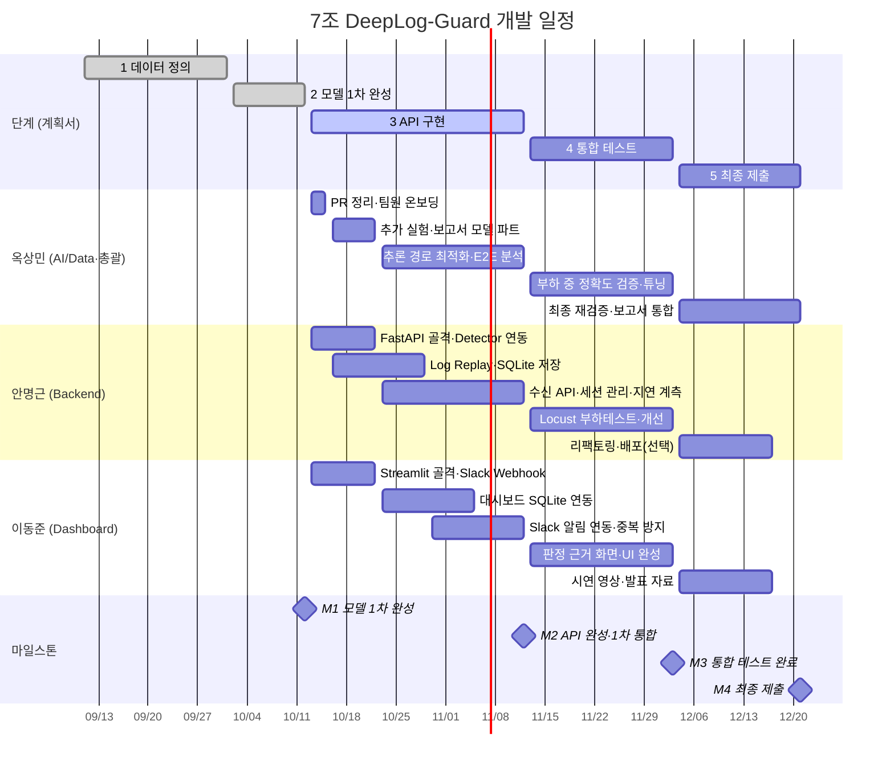

# 개발 일정 (5~15주차)

- 작성: 옥상민 / 2026-10-12 (5주차 월요일)
- 기간: 2026-09-11 ~ 2026-12-21. 주차는 9/11(금) 시작 기준 **금~목** 7일 단위
- 기준: 계획서 [표 1] 3주 단위 5단계 (데이터 정의 → 모델 1차 → API 구현 → 통합 테스트 → 최종 제출)

## 현재 상황 (10/12)

| 영역 | 담당 | 상태 |
|---|---|---|
| 데이터·모델 (1~2단계) | 옥상민 | **완료** — 최종 모델 Autoencoder test F1 0.977 (`docs/plan_week4-6.md`). 원래 마감 10/22 보다 10일 앞섬 |
| 백엔드 (FastAPI·Log Replay·SQLite) | 안명근 | 진행 상황 확인 필요 |
| 대시보드·알림 (Streamlit·Slack) | 이동준 | 진행 상황 확인 필요 |

**전략:** 모델 단계에서 앞당겨진 10일을 통합·실측에 쓴다. `Detector`·`OnlineParser` 인터페이스가 이미 확정되어 있어
(`docs/interface_backend.md`) 백엔드·대시보드는 원래 7주차 시작 예정이던 작업을 **지금 바로** 시작할 수 있다.

## 마일스톤

| | 날짜 | 내용 | 확인 기준 |
|---|---|---|---|
| M1 | 10/22 (6주차) | 모델 1차 완성 | ✅ 10/12 완료 |
| M2 | 11/12 (9주차) | API 완성 · 1차 통합 | Log Replay → FastAPI → SQLite → Slack·대시보드가 한 번에 동작, E2E 지연 1차 측정 |
| M3 | 12/3 (12주차) | 통합 테스트 완료 | 계획서 목표 ①~⑥ 실측표 완성 (E2E 2초, Locust 500 logs/s × 1분, 오류율 1% 미만) |
| M4 | 12/21 (15주차) | 최종 제출 | 보고서 · 시연 영상 · 코드 |

## 주차별 상세

### 2단계 마무리 — 5~6주차 (10/9 ~ 10/22)

| 주차 | 옥상민 | 안명근 | 이동준 |
|---|---|---|---|
| **5주차** 10/9~10/15 (현재) | 1~6단계 PR 리뷰·merge, 팀원 온보딩 (`make setup` → `make data`, Detector 사용법 시연) | 환경 세팅, FastAPI 골격 + `OnlineParser`·`load_detector` 연동 프로토타입 | 환경 세팅, Streamlit 골격 (목업 데이터), Slack 워크스페이스·Incoming Webhook 발급 (`.env`) |
| **6주차** 10/16~10/22 | 추가 실험 (윈도우 25·30), 보고서 모델 파트 초안 (방법·결과·그래프), **SQLite 스키마 합의 주도** | Log Replay 모듈 (test 블록을 원본 순서·속도 조절로 재생), SQLite 저장 | Slack 메시지 포맷 (블록 ID·점수·템플릿·판정 근거), 대시보드 KPI 카드·이상 스코어 추이 |

### 3단계 API 구현 — 7~9주차 (10/23 ~ 11/12)

| 주차 | 옥상민 | 안명근 | 이동준 |
|---|---|---|---|
| **7주차** 10/23~10/29 | API 안의 추론 경로 검토, 필요 시 Detector 배치 판정 메서드 추가 | 로그 수신 API (단건·배치), 블록별 이벤트 이력 관리, **세션 종료 타임아웃** 구현 | 대시보드 ↔ SQLite 실데이터 연동 |
| **8주차** 10/30~11/5 | E2E 지연 측정 스크립트·분석, 병목 최적화 | 지연 계측 로깅 (수신→판정, Replay 전송→Slack 요청 완료) | 판정 → Slack 알림 연동, **알림 중복 방지** (블록당 1회) |
| **9주차** 11/6~11/12 | **[M2] 1차 통합 데모** — 전원: Replay → API → SQLite → Slack + 대시보드 전체 흐름, E2E 2초 1차 측정 | | |

### 4단계 통합 테스트 — 10~12주차 (11/13 ~ 12/3)

| 주차 | 옥상민 | 안명근 | 이동준 |
|---|---|---|---|
| **10주차** 11/13~11/19 | Replay 결과가 오프라인 test 결과(F1 0.977)와 일치하는지 검증 | Locust 시나리오 (500 logs/s × 1분) | 로그 스트림 테이블, 전후 로그, 판정 근거(복원 실패 이벤트) 표시 |
| **11주차** 11/20~11/26 | 운영 오탐 튜닝 (알림 임계 조정 실험), 성능 회귀 테스트 | Locust 실측, 병목 개선 (워커 수, 배치 처리) | UI 다듬기, 알림 이력 화면 |
| **12주차** 11/27~12/3 | **[M3] 통합 테스트 완료** — 계획서 목표 ①~⑥ 실측표 작성 | (선택) Docker 이미지 | 대시보드 최종 점검 |

### 5단계 최종 제출 — 13~15주차 (12/4 ~ 12/21)

| 주차 | 옥상민 | 안명근 | 이동준 |
|---|---|---|---|
| **13주차** 12/4~12/10 | 전체 파이프라인 재실행으로 최종 성능 재검증, 보고서 통합 | 백엔드 리팩토링·문서화 | 대시보드 리팩토링·문서화 |
| **14주차** 12/11~12/17 | 보고서 퇴고, 발표 자료 검토 (**일정 버퍼**) | 시연 환경 준비 | 시연 영상 촬영·편집, 발표 자료 |
| **15주차** 12/18~12/21 | **[M4] 최종 제출 (12/21)** | | |

## 계획서 목표별 담당·검증 시점

| 목표 | 상태 | 남은 일 | 담당 | 시점 |
|---|---|---|---|---|
| ① F1 ≥ 0.85 | ✅ 0.977 | Replay 환경에서 같은 결과 재현 | 옥상민 | 10주차 |
| ② Rule-Based +10%p | ✅ +40.4%p | — | — | — |
| ③ 추론 p95 ≤ 1초 · E2E ≤ 2초 | 모델 구간 p95 0.10ms | API·Slack 포함 E2E 실측 | 안명근·옥상민 | 8~9주차 |
| ④ 500 logs/s × 1분, 오류율 < 1% | 모델 구간 약 10,700줄/초 | Locust 실측 | 안명근 | 10~11주차 |
| ⑤ 두 모델 비교·채택 | ✅ Autoencoder | — | — | — |
| ⑥ 대시보드·Slack 자동 알림 | 미착수 | 구현·연동 | 이동준 | 5~11주차 |

## 운영 규칙

- **주 1회 정기 회의** (요일 미정): 지난주 결과, 이번 주 목표, 막힌 점. 회의록은 GitHub Issue 나 `docs/meetings/` 에 남긴다
- 작업은 `feat/<영역>-<내용>` 브랜치 → PR → 다른 팀원 1명 리뷰 후 merge
- 인터페이스(Detector 반환 형식, SQLite 스키마)를 바꿀 때는 PR 설명에 영향 받는 팀원을 명시
- Slack Webhook URL 등 비밀값은 `.env` 에만 (커밋 금지)

## 정해야 할 것

| 항목 | 결정 필요 시점 | 비고 |
|---|---|---|
| 정기 회의 요일·시간 | 5주차 | |
| 학과 중간발표·기말 일정 | 5주차 | 확인 후 이 일정표에 반영 |
| SQLite 스키마 | 6주차 | 제안: `docs/interface_backend.md` |
| 세션 종료 타임아웃 | 7주차 | HDFS 로그에 블록 종료 표시가 없음. 마지막 로그 후 N초 |
| 시연·배포 환경 | 11주차 | 학교 서버 / 로컬 / Docker |
